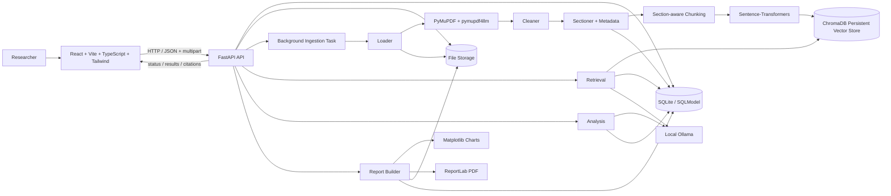

# AI Based Research Paper Analyst — System Design

## 1. Scope

The system accepts research-paper PDFs or supported paper URLs, extracts structured paper content, indexes section-aware chunks, analyzes the papers with an LLM, and exposes summaries, findings, methodology, limitations, grounded Q&A, multi-paper comparison, and downloadable Markdown/PDF reports.

The design follows the locked stack:

- Backend: Python 3.11, FastAPI, SQLModel, SQLite
- PDF parsing: PyMuPDF + pymupdf4llm
- Embeddings: sentence-transformers
- Vector store: ChromaDB, persistent on disk
- LLM: local Ollama chat API
- Reports: Markdown + ReportLab PDF
- Charts: matplotlib, only from extracted numeric values
- Frontend: React + Vite + TypeScript + Tailwind
- Server state: React Query
- Packaging: Docker + Docker Compose

## 2. Architecture



### Runtime boundaries

- The browser never accesses SQLite, ChromaDB, or stored files directly.
- FastAPI owns API validation, authorization boundaries, persistence, retrieval orchestration, and report delivery.
- Ingestion runs as a FastAPI background task for the first deployment. It persists job state so the UI can safely poll after refresh.
- ChromaDB stores embeddings and retrieval metadata; SQLite remains the source of truth for paper metadata, jobs, reports, and chat history.
- File storage contains original uploaded PDFs and generated report/chart files.
- Analysis and chat use the local Ollama service configured by `LLM_MODEL` and
  `OLLAMA_BASE_URL`.

## 3. Core components

| Component | Responsibility |
|---|---|
| `main.py` | Create FastAPI app, register routers, startup/shutdown wiring |
| `config.py` | Environment-backed settings and validation |
| `db.py` | SQLite engine/session setup |
| `models.py` | SQLModel tables and relationships |
| `api/papers.py` | Upload, URL ingest, paper library, paper status, summary/details |
| `api/chat.py` | Grounded paper/collection Q&A and chat history |
| `api/compare.py` | Multi-paper comparison |
| `api/reports.py` | Report generation and file download |
| `ingestion/loader.py` | Accept local upload or validated remote paper URL |
| `ingestion/parser.py` | PDF text/layout extraction and scanned-PDF detection |
| `ingestion/cleaner.py` | Remove repeated headers/footers and irrelevant extraction noise |
| `ingestion/sectioner.py` | Detect logical paper sections |
| `ingestion/metadata.py` | Extract title, authors, venue, year, DOI/arXiv identifiers |
| `retrieval/embedder.py` | Sentence-transformer embedding generation |
| `retrieval/store.py` | Chroma collection writes/reads |
| `retrieval/search.py` | Semantic retrieval, filtering, citation mapping |
| `llm/base.py` | Small provider contract shared by LLM implementations |
| `llm/ollama_client.py` | Communicate with the configured local Ollama model |
| `llm/prompts.py` | Task-specific grounded prompts |
| `analysis/*` | Summary, findings, methodology, limitations, comparison, and Q&A orchestration |
| `reports/*` | Markdown, numeric-data charts, and PDF generation |
| React pages/components | Paper library, paper details, chat, comparison, upload, report actions |

## 4. Data flow

### 4.1 Upload and ingest

1. `POST /api/papers/upload` receives a multipart PDF.
2. Validate extension, MIME type, configured size limit, and filename.
3. Hash the file with SHA-256.
4. If the hash already exists, return the existing paper/job instead of ingesting again.
5. Store the original file using an internal generated ID; never use the client filename as a filesystem path.
6. Create a `paper` row and an `ingestion_job` row with status `queued`.
7. Start the background ingestion task and return the paper/job identifiers.
8. Loader opens the stored PDF and checks that it is a valid PDF.
9. Parser extracts layout-aware text with PyMuPDF/pymupdf4llm.
10. Detect scanned/image-only documents before accepting extraction. If usable text is absent, mark the job `failed` with an explicit OCR-required error.
11. Cleaner removes repeated headers/footers, extraction noise, and duplicated references where they are not part of the requested analysis.
12. Sectioner assigns text to logical sections such as abstract, introduction, related work, methods, experiments/results, discussion, conclusion, and references.
13. Metadata extraction records title, authors, venue, year, DOI, and arXiv identifier when available.
14. Chunks are created from sectioned text with stable chunk IDs and source page numbers.
15. Sentence-transformers generates embeddings. Existing paper/chunk hashes are reused when the same content is already indexed.
16. Chunks and embeddings are written to ChromaDB with metadata.
17. Paper metadata and ingestion status are updated in SQLite.
18. A detailed per-paper analysis is generated from the extracted sections and available figure captions, table contents, equations, and calculations, then cached in SQLite.
19. Job status becomes `ready`.
20. On a boundary failure, status becomes `failed` with a safe, user-readable error.

The UI polls `GET /api/papers/{paper_id}/status` until `ready` or `failed`.
When ready, the UI loads `GET /api/papers/{paper_id}/assets` to display
extractable figures, rendered page previews for vector figures, detected
tables, and equations/calculations with page references.

### 4.2 Ask a question

1. Browser sends `POST /api/chat/questions` with `paper_ids`, question, and optional section filter.
2. API validates that every referenced paper is `ready`.
3. Query is embedded using the same embedding model used for indexed chunks.
4. Chroma performs semantic search with paper and section metadata filters.
5. Retrieval returns the highest-ranked chunks, preserving paper ID, section, page, chunk ID, and text.
6. If retrieval does not meet the confidence threshold, return `not found in the provided papers` without calling the LLM for a factual answer.
7. Otherwise, the LLM receives only the retrieved evidence plus the question and grounding instructions.
8. The structured Q&A response is validated with Pydantic.
9. If JSON validation fails, retry exactly once with a correction prompt. A second failure is returned as a clear analysis error.
10. Store the question, answer, and citation records in chat history.
11. Return the answer and clickable citations. Each citation contains paper ID, page, section, and chunk ID so the UI can open the corresponding source passage.

### 4.3 Compare papers

1. Browser sends `POST /api/compare`.
2. API validates two or more ready papers.
3. Retrieval gathers evidence for the comparison dimensions: problem, method, dataset, metrics, results, and limitations.
4. Analysis prompts request one aligned JSON object per dimension and require citations for every paper-specific claim.
5. The response is Pydantic-validated and retried once if invalid.
6. Numeric results are normalized only when the source explicitly reports them.
7. Matplotlib charts are generated only for extracted comparable numeric values.
8. The comparison result is returned as an aligned table with citations per cell.
9. No missing value is replaced with an invented estimate; it remains `Not reported`.

### 4.4 Generate report

1. Browser sends `POST /api/reports` with selected paper IDs and report options.
2. API validates all selected papers and required analysis data.
3. Builder assembles executive summary, key points, comparison table when applicable, visualizations, citations, and references.
4. Markdown is written to file storage.
5. Matplotlib charts are included only when backed by extracted numeric values.
6. ReportLab converts the structured report into PDF.
7. SQLite records the report metadata and paths.
8. API returns report identifiers and download endpoints.
9. The UI downloads the generated `.md` or `.pdf`.

## 5. Data model

SQLite is the source of truth for application state.

### `paper`

| Column | Type | Notes |
|---|---|---|
| `id` | UUID/string | Primary key |
| `file_hash` | string | SHA-256; unique for dedupe |
| `original_filename` | string | Display name only |
| `source_type` | string | `upload` or `url` |
| `source_url` | string nullable | Original validated URL when applicable |
| `storage_path` | string | Internal generated path |
| `title` | string nullable | Extracted metadata |
| `authors_json` | text nullable | JSON array of authors |
| `venue` | string nullable | Journal/conference/source |
| `year` | integer nullable | Publication year |
| `doi` | string nullable | DOI if available |
| `arxiv_id` | string nullable | arXiv identifier if available |
| `status` | string | `queued`, `processing`, `ready`, `failed` |
| `error_message` | text nullable | Safe failure message |
| `summary_json` | text nullable | Cached validated summary |
| `created_at` | datetime | Creation time |
| `updated_at` | datetime | Last state change |

Unique constraint: `file_hash`.

### `ingestion_job`

| Column | Type | Notes |
|---|---|---|
| `id` | UUID/string | Primary key |
| `paper_id` | UUID/string | Foreign key to `paper.id` |
| `status` | string | `queued`, `processing`, `ready`, `failed` |
| `progress` | integer | 0–100 |
| `stage` | string nullable | Current user-facing stage |
| `error_message` | text nullable | Safe error |
| `created_at` | datetime | Creation time |
| `updated_at` | datetime | Last update |

Relationship: many jobs may refer to one paper over time, but only one active job is permitted.

### `chat_session`

| Column | Type | Notes |
|---|---|---|
| `id` | UUID/string | Primary key |
| `title` | string nullable | UI label |
| `created_at` | datetime | Creation time |
| `updated_at` | datetime | Last activity |

### `chat_session_paper`

| Column | Type | Notes |
|---|---|---|
| `session_id` | UUID/string | FK to `chat_session.id` |
| `paper_id` | UUID/string | FK to `paper.id` |

Composite primary key: `session_id + paper_id`.

### `chat_message`

| Column | Type | Notes |
|---|---|---|
| `id` | UUID/string | Primary key |
| `session_id` | UUID/string | FK to `chat_session.id` |
| `role` | string | `user` or `assistant` |
| `content` | text | Message text |
| `citations_json` | text nullable | JSON citation list |
| `created_at` | datetime | Creation time |

### `report`

| Column | Type | Notes |
|---|---|---|
| `id` | UUID/string | Primary key |
| `title` | string | Report title |
| `format` | string | `md` or `pdf` |
| `storage_path` | string | Generated file path |
| `paper_ids_json` | text | Included papers |
| `created_at` | datetime | Creation time |

### Relationships

```text
paper 1 ─── N ingestion_job

chat_session N ─── N paper
       │
       └── 1 ─── N chat_message

report N ─── N paper (stored as a report paper-ID list)
```

The report-to-paper relationship is intentionally kept as a JSON list because reports are immutable generated artifacts and do not require relational querying in the application.

## 6. ChromaDB collection schema

Collection name: `paper_chunks`.

Each Chroma record contains:

```text
id:
  <paper_id>:<chunk_number>

document:
  cleaned chunk text

embedding:
  sentence-transformers vector

metadata:
  paper_id: string
  section: string
  page: integer
  chunk_id: string
  content_type: "text" | "table" | "figure_caption"
  content_hash: string
```

`paper_id`, `section`, and `page` are retrieval filters and citation anchors. `content_hash` supports embedding deduplication.

## 7. Chunking strategy

Chunk after section detection rather than across the entire document.

- Target size: about 900 tokens.
- Overlap: about 120 tokens.
- Minimum useful chunk: about 150 tokens, except short sections such as an abstract.
- Never merge text across detected logical sections.
- Preserve page boundaries in metadata even when a chunk spans two pages.
- Keep headings with the first chunk of their section.
- Tables are converted into compact text preserving column/row meaning and stored with `content_type=table`.
- Figure captions are kept as their own chunks when sufficiently informative and stored with `content_type=figure_caption`.
- References are indexed only when needed for citation/reference lookup; they are not allowed to dominate normal semantic retrieval.
- Very long tables are split by logical row groups while retaining the table heading and page number.

The target size balances semantic completeness for methods/results passages against retrieval precision and local-model context limits. The overlap preserves definitions and conclusions that cross a chunk boundary.

## 8. Retrieval strategy

Default retrieval:

- Initial semantic retrieval: top 12 chunks.
- Apply paper and optional section filters before ranking when supplied by the caller.
- Remove near-duplicate chunks from the same page/section when they add no new evidence.
- Final evidence set sent to the LLM: up to 6 strongest chunks, subject to context limits.
- Optional reranking is permitted only if a real reranker implementation is added later; the baseline implementation uses embedding similarity and does not require an extra dependency.

Retrieval confidence is based on the best and aggregate similarity scores after duplicate reduction. A configurable threshold prevents weak evidence from reaching the factual-answer path.

### Citation mapping

Every retrieved chunk carries:

```text
paper_id
chunk_id
section
page
text
```

The LLM receives stable citation labels such as `[P1-S3]`. The server maps those labels back to database/vector-store metadata before returning the answer. The frontend renders each citation as a link that opens the source passage with its page number.

The LLM is never trusted to invent citation metadata. Only retrieved chunk IDs are accepted by the API.

## 9. Grounding rules

1. The factual answer must be based only on retrieved chunks from the selected papers.
2. Every factual claim that depends on paper content must have one or more retrieved citations.
3. The model must not use general world knowledge to fill missing paper information.
4. If evidence is absent or retrieval confidence is below threshold, return exactly:
   `not found in the provided papers`
5. Missing comparison fields are reported as `Not reported`.
6. Citation IDs not present in the retrieved evidence set are invalid and cause the response to fail validation.
7. Structured LLM output is validated with Pydantic.
8. Invalid JSON is repaired by one retry only; a second failure is a clear system error, not a fabricated response.

## 10. Ingestion status and polling

The lifecycle is:

```text
queued -> processing -> ready
                     \
                      -> failed
```

`processing` exposes a user-facing stage such as:

- Downloading paper
- Extracting text
- Detecting sections
- Creating embeddings
- Indexing chunks
- Generating summary

The browser polls:

```http
GET /api/papers/{paper_id}/status
```

Recommended polling interval: 1.5–2 seconds while processing, stopping immediately at `ready` or `failed`.

A failed job is terminal for that run. Retrying starts a new ingestion job without duplicating the paper when the source hash is unchanged.

## 11. API contract

Base path: `/api`.

All JSON errors use:

```json
{
  "error": {
    "code": "machine_readable_code",
    "message": "User-readable message"
  }
}
```

### Papers

#### `POST /api/papers/upload`

Multipart form field:

```text
file: PDF
```

Success `202`:

```json
{
  "paper_id": "paper-id",
  "job_id": "job-id",
  "status": "queued"
}
```

Errors:

- `400 INVALID_FILE`
- `413 FILE_TOO_LARGE`
- `415 UNSUPPORTED_FILE`
- `409 DUPLICATE_PAPER`

#### `POST /api/papers/url`

Request:

```json
{
  "url": "https://arxiv.org/pdf/..."
}
```

Success `202`:

```json
{
  "paper_id": "paper-id",
  "job_id": "job-id",
  "status": "queued"
}
```

Errors:

- `400 INVALID_URL`
- `403 URL_BLOCKED`
- `413 FILE_TOO_LARGE`
- `415 UNSUPPORTED_CONTENT`
- `502 DOWNLOAD_FAILED`
- `409 DUPLICATE_PAPER`

#### `GET /api/papers`

Response:

```json
{
  "items": [
    {
      "id": "paper-id",
      "title": "Paper title",
      "year": 2025,
      "status": "ready"
    }
  ]
}
```

`200`.

#### `GET /api/papers/{paper_id}`

Response:

```json
{
  "id": "paper-id",
  "title": "Paper title",
  "authors": ["Author A"],
  "venue": "Venue",
  "year": 2025,
  "doi": null,
  "arxiv_id": "2501.12345",
  "status": "ready"
}
```

Errors: `404 PAPER_NOT_FOUND`.

#### `GET /api/papers/{paper_id}/status`

Response:

```json
{
  "paper_id": "paper-id",
  "status": "processing",
  "progress": 65,
  "stage": "Creating embeddings",
  "error": null
}
```

Errors: `404 PAPER_NOT_FOUND`.

#### `GET /api/papers/{paper_id}/summary`

Response:

```json
{
  "paper_id": "paper-id",
  "summary": "...",
  "key_points": ["..."],
  "citations": [
    {
      "paper_id": "paper-id",
      "chunk_id": "paper-id:12",
      "page": 4,
      "section": "results"
    }
  ]
}
```

Errors: `404 PAPER_NOT_FOUND`, `409 PAPER_NOT_READY`, `502 ANALYSIS_FAILED`.

#### `GET /api/papers/{paper_id}/source/{chunk_id}`

Response:

```json
{
  "paper_id": "paper-id",
  "chunk_id": "paper-id:12",
  "page": 4,
  "section": "results",
  "text": "Source passage..."
}
```

Errors: `404 SOURCE_NOT_FOUND`.

### Chat

#### `POST /api/chat/sessions`

Request:

```json
{
  "paper_ids": ["paper-1", "paper-2"],
  "title": "Methods discussion"
}
```

Response:

```json
{
  "session_id": "session-id",
  "paper_ids": ["paper-1", "paper-2"]
}
```

Errors: `404 PAPER_NOT_FOUND`, `409 PAPER_NOT_READY`.

#### `GET /api/chat/sessions/{session_id}/messages`

Response:

```json
{
  "items": [
    {
      "id": "message-id",
      "role": "user",
      "content": "What dataset was used?",
      "citations": []
    }
  ]
}
```

Errors: `404 SESSION_NOT_FOUND`.

#### `POST /api/chat/questions`

Request:

```json
{
  "session_id": "session-id",
  "question": "What dataset was used?",
  "section": "results"
}
```

Response:

```json
{
  "answer": "The paper reports ...",
  "citations": [
    {
      "paper_id": "paper-id",
      "chunk_id": "paper-id:21",
      "page": 7,
      "section": "results"
    }
  ],
  "found": true
}
```

For insufficient evidence:

```json
{
  "answer": "not found in the provided papers",
  "citations": [],
  "found": false
}
```

Errors: `400 INVALID_QUESTION`, `404 SESSION_NOT_FOUND`, `409 PAPER_NOT_READY`, `502 ANALYSIS_FAILED`.

### Comparison

#### `POST /api/compare`

Request:

```json
{
  "paper_ids": ["paper-1", "paper-2"]
}
```

Response:

```json
{
  "papers": [
    {"id": "paper-1", "title": "Paper A"},
    {"id": "paper-2", "title": "Paper B"}
  ],
  "rows": [
    {
      "dimension": "method",
      "cells": [
        {
          "paper_id": "paper-1",
          "value": "...",
          "citations": [
            {
              "paper_id": "paper-1",
              "chunk_id": "paper-1:9",
              "page": 3,
              "section": "methods"
            }
          ]
        }
      ]
    }
  ],
  "charts": []
}
```

Errors: `400 TOO_FEW_PAPERS`, `404 PAPER_NOT_FOUND`, `409 PAPER_NOT_READY`, `502 ANALYSIS_FAILED`.

### Reports

#### `POST /api/reports`

Request:

```json
{
  "paper_ids": ["paper-1", "paper-2"],
  "format": "pdf"
}
```

Response:

```json
{
  "report_id": "report-id",
  "format": "pdf",
  "download_url": "/api/reports/report-id/download"
}
```

Errors: `400 INVALID_FORMAT`, `404 PAPER_NOT_FOUND`, `409 PAPER_NOT_READY`, `502 REPORT_FAILED`.

#### `GET /api/reports`

Response:

```json
{
  "items": [
    {
      "id": "report-id",
      "title": "Research Paper Analysis",
      "format": "pdf",
      "created_at": "2026-10-07T12:00:00Z"
    }
  ]
}
```

#### `GET /api/reports/{report_id}/download`

Returns the stored `.md` or `.pdf` file.

Errors: `404 REPORT_NOT_FOUND`, `410 REPORT_FILE_MISSING`.

## 12. Caching and deduplication

### File dedupe

SHA-256 of the original PDF is the canonical document identity. A repeated upload returns the existing paper rather than creating another vector index.

### Embedding cache

The effective cache key is:

```text
embedding_model + content_hash
```

At the application level, chunks with the same content hash are not embedded again during re-ingestion.

### Summary cache

The paper summary is stored as validated JSON in `paper.summary_json`. It is regenerated only when the paper content or configured analysis prompt/model version changes.

The cache does not bypass grounding; a cached summary remains tied to the indexed paper version.

## 13. Failure modes

| Failure | Detection | Handling |
|---|---|---|
| Scanned PDF | Very low usable text density / no extractable text | Fail ingestion with `OCR_REQUIRED`; never continue with empty text |
| Oversized upload/download | Configured byte limit | Reject with `413` |
| Non-paper PDF | Missing meaningful paper structure/metadata and insufficient research sections | Mark failed with `NOT_A_RESEARCH_PAPER` |
| Corrupt PDF | Parser exception | Mark failed with `INVALID_PDF` |
| Malformed URL | URL parser/allowlist validation | `400 INVALID_URL` |
| SSRF target | Block private/loopback/link-local/reserved addresses | `403 URL_BLOCKED` |
| Remote download failure | Timeout, bad status, content mismatch | `502 DOWNLOAD_FAILED` |
| LLM timeout | Provider timeout | Return retryable `502 LLM_TIMEOUT` |
| LLM rate limit | Provider 429 | Return `502 LLM_RATE_LIMITED` with retry guidance |
| Invalid LLM JSON | Pydantic validation failure | One correction retry, then `502 INVALID_LLM_OUTPUT` |
| Missing report file | File path no longer exists | `410 REPORT_FILE_MISSING` |
| Vector-store failure | Chroma exception | Fail ingestion or query with explicit infrastructure error |

No error handler should silently convert missing evidence into a successful result.

## 14. Security

### File validation

- Accept only PDF content.
- Validate extension and detected content type.
- Enforce a maximum upload/download byte size before storing the complete file.
- Store files under generated IDs, never user-controlled paths.
- Do not execute or render embedded active content.

### SSRF protection

For URL ingestion:

1. Allow only `https` by default.
2. Resolve the hostname before connecting.
3. Reject loopback, private, link-local, multicast, unspecified, and other reserved IP ranges.
4. Disable redirects to a newly validated-untrusted target unless each redirect destination is revalidated.
5. Enforce connection and total download timeouts.
6. Require the final response to be a PDF with a safe size limit.
7. Reject localhost-style hostnames and unsupported URL schemes.

### Path traversal

Client filenames are display metadata only. Internal paths are generated from UUIDs and controlled directory roots. No API accepts arbitrary filesystem paths.

### Rate limiting

Apply request limits at the API boundary, with stricter limits for:

- upload/download URL ingestion
- LLM-backed Q&A
- comparison
- report generation

The initial implementation uses a FastAPI-compatible rate-limit middleware/dependency backed by in-process state for the single-container deployment.

## 15. Long-paper summarization

For papers whose extracted text exceeds the configured analysis context:

1. Group chunks by logical section.
2. Summarize each section with citations.
3. Combine section summaries using a second LLM pass.
4. Generate the final executive summary and key points from the section summaries.
5. Preserve citations from the underlying chunks.

This is a map-reduce flow and prevents truncating the end of long methods/results sections.

## 16. LLM provider contract

`llm/base.py` defines the interface used by analysis code and test doubles.

Required operations:

```text
generate_structured(prompt, schema)
```

The interface returns validated structured data or a provider/validation error.

The application uses Ollama's local `/api/chat` endpoint and structured-output
support; no external LLM API key is required.

## 17. Prompt and structured-output rules

`llm/prompts.py` contains plain constants for:

- summary
- key findings
- methodology
- limitations
- comparison
- question answering

Each prompt:

- receives only the evidence required for the task;
- requires JSON matching the Pydantic schema;
- requires citation IDs for paper-derived claims;
- forbids invented values;
- explicitly treats missing information as `Not reported` or `not found in the provided papers`.

Invalid structured output is retried once. A second failure is surfaced as an analysis error.

## 18. Reports and charts

A report contains:

1. Executive summary
2. Key points
3. Detailed findings
4. Methodology
5. Results
6. Limitations
7. Comparison table when multiple papers are selected
8. Charts when valid numeric comparisons exist
9. Citations
10. References

Charts are generated only from values explicitly extracted from source papers. If comparable numeric values are absent, no chart is generated.

Chart metadata retains the source paper and page for every plotted value.

## 19. API/UI state model

The frontend treats these states as first-class:

```text
idle
uploading
queued
processing
ready
error
```

Paper library badges reflect the persisted backend status.

Every major view has:

- loading skeleton
- empty state
- error state with retry
- ready state

The browser does not infer processing completion from elapsed time.

## 20. Security and grounding assumptions for the UI

- All citation links use server-issued paper/chunk identifiers.
- The UI never accepts a citation URL from the LLM.
- Download URLs are generated by the backend.
- User-visible text avoids marketing claims and uses concrete state descriptions such as `Processing paper, extracting sections`.
- Inputs have accessible labels and visible focus states.
- Keyboard navigation is supported for tabs, upload controls, citation links, comparison controls, and report actions.

## 21. Scaling at 100x load

At roughly 100x the initial single-instance load, SQLite/background tasks should be replaced by a production relational database and durable job queue, while ingestion workers become separate processes and Chroma moves to a separately managed vector service or dedicated persistent deployment. Object storage should replace local report/PDF storage, and LLM/embedding work should be independently rate-limited. The API and React frontend can remain stateless and scale horizontally.

## 22. Evaluation plan

Use a small fixed evaluation set containing several openly accessible research papers with known facts in their abstracts, methods, datasets, metrics, and limitations.

Recommended evaluation categories:

| Test | Expected check |
|---|---|
| Paper A summary | Title, problem, method, and main result match source |
| Paper A dataset question | Exact dataset name is returned with correct page citation |
| Paper A limitation question | Limitation is grounded in discussion/limitations text |
| Paper A absent-fact question | Returns `not found in the provided papers` |
| Papers A + B comparison | Problem, method, dataset, metrics, results, and limitations align by paper |
| Numeric comparison | Chart values exactly match reported source numbers |
| Scanned paper | Ingestion fails with `OCR_REQUIRED` |
| Duplicate upload | Existing paper is reused by SHA-256 |
| Long paper | Summary includes evidence from multiple logical sections |
| Citation click | Returned citation opens the exact stored passage and page |

Evaluation should record:

- metadata extraction accuracy;
- section detection accuracy;
- retrieval recall for known facts;
- citation correctness;
- grounded-answer rate;
- unsupported-answer rejection rate;
- comparison-field accuracy;
- numeric extraction/chart accuracy.

A regression test should fail if an answer contains a citation ID that was not retrieved or if an absent fact produces anything other than the required not-found response.

## 23. Final project tree

```text
research-paper-analyst/
├── README.md
├── docker-compose.yml
├── .env.example
├── docs/
│   └── system_design.md
├── backend/
│   ├── requirements.txt
│   ├── Dockerfile
│   ├── app/
│   │   ├── main.py
│   │   ├── config.py
│   │   ├── db.py
│   │   ├── models.py
│   │   ├── api/
│   │   │   ├── papers.py
│   │   │   ├── chat.py
│   │   │   ├── compare.py
│   │   │   └── reports.py
│   │   ├── ingestion/
│   │   │   ├── loader.py
│   │   │   ├── parser.py
│   │   │   ├── cleaner.py
│   │   │   ├── sectioner.py
│   │   │   └── metadata.py
│   │   ├── retrieval/
│   │   │   ├── embedder.py
│   │   │   ├── store.py
│   │   │   └── search.py
│   │   ├── llm/
│   │   │   ├── base.py
│   │   │   ├── ollama_client.py
│   │   │   └── prompts.py
│   │   ├── analysis/
│   │   │   ├── summarize.py
│   │   │   ├── extract.py
│   │   │   ├── compare.py
│   │   │   └── qa.py
│   │   └── reports/
│   │       ├── builder.py
│   │       ├── charts.py
│   │       └── pdf.py
│   └── tests/
│       ├── test_sectioner.py
│       ├── test_cleaner.py
│       ├── test_chunking.py
│       ├── test_retrieval.py
│       ├── test_api.py
│       └── test_e2e.py
└── frontend/
    ├── package.json
    ├── vite.config.ts
    ├── tailwind.config.ts
    ├── Dockerfile
    └── src/
        ├── main.tsx
        ├── App.tsx
        ├── api/
        ├── pages/
        ├── components/
        └── hooks/
```

No extra service, abstraction, worker package, or database layer is required for the locked Phase 1 design.

## 24. Dependency manifest

Versions are pinned so the build is reproducible.

### Backend — `backend/requirements.txt`

| Dependency | Version | Reason |
|---|---:|---|
| `fastapi` | `0.115.6` | HTTP API and request validation |
| `uvicorn[standard]` | `0.34.0` | ASGI server |
| `sqlmodel` | `0.0.22` | SQLite models and sessions |
| `pydantic-settings` | `2.7.1` | Environment-backed configuration |
| `pymupdf` | `1.25.1` | PDF parsing and page access |
| `pymupdf4llm` | `0.0.17` | Layout-aware PDF text extraction |
| `sentence-transformers` | `3.3.1` | Local free text embeddings |
| `chromadb` | `0.6.3` | Persistent vector storage and semantic retrieval |
| `httpx` | `0.28.1` | URL downloads and API calls |
| `python-multipart` | `0.0.20` | FastAPI multipart PDF uploads |
| `reportlab` | `4.2.5` | PDF report generation |
| `matplotlib` | `3.10.0` | Source-backed numeric charts |
| `slowapi` | `0.1.9` | API rate limiting |
| `pytest` | `8.3.4` | Backend tests |
| `pytest-asyncio` | `0.25.0` | Async API/e2e tests |
| `ruff` | `0.9.1` | Python linting |
| `black` | `24.10.0` | Python formatting |

### Frontend — `frontend/package.json`

Runtime dependencies:

| Dependency | Version | Reason |
|---|---:|---|
| `react` | `18.3.1` | UI framework |
| `react-dom` | `18.3.1` | Browser rendering |
| `@tanstack/react-query` | `5.62.8` | Server state, polling, caching |
| `react-router-dom` | `7.1.1` | Page routing |

Development dependencies:

| Dependency | Version | Reason |
|---|---:|---|
| `vite` | `6.0.5` | Frontend development/build tool |
| `typescript` | `5.7.2` | Strict TypeScript |
| `@vitejs/plugin-react` | `4.3.4` | React support in Vite |
| `tailwindcss` | `3.4.17` | Utility-first UI styling |
| `postcss` | `8.4.49` | Tailwind CSS processing |
| `autoprefixer` | `10.4.20` | CSS vendor prefixing |
| `eslint` | `9.17.0` | TypeScript/React linting |
| `prettier` | `3.4.2` | TypeScript/React formatting |
| `@types/react` | `18.3.18` | React TypeScript types |
| `@types/react-dom` | `18.3.5` | React DOM TypeScript types |

Frontend component tests are intentionally deferred to the frontend phase; their exact test dependencies will be added only when those tests are implemented, keeping the dependency rule strict.

## 25. Locked implementation decisions

- PyMuPDF/pymupdf4llm is the only PDF extraction path; PyPDF2 is not used.
- Sentence-transformers provides local embeddings; no paid embedding API is required.
- ChromaDB persists on disk for the initial deployment.
- The LLM contract keeps analysis independent from the Ollama HTTP client.
- No generic repository, service, helper, manager, or utility abstraction is introduced without a concrete need.
- SQLite remains the application database for the initial deployment.
- Background ingestion uses FastAPI's background-task mechanism rather than adding a separate queue service.
- Reports are generated from stored structured analysis and source-backed chart data.
- The frontend uses React Query for server state and does not use Redux.
